# Safe Identity Lifecycle

Salesforce as the system of record for identity. Student records in Salesforce drive the whole Google account lifecycle (create, OU placement, group membership, suspend, reactivate, password reprovision, and rename) through the Google Admin SDK Directory API, with least-privilege access at every layer and every call logged.

> **Status: built and proven live.** Joiner, mover, leaver, and return paths, retries with backoff, failure alerts, a daily reconciliation sweep, and two staff actions (reprovision and rename) all run against a real Google Cloud Identity tenant from a Salesforce Developer Edition org. 144 Apex tests. The build log is in [`docs/PROGRESS-identity.md`](docs/PROGRESS-identity.md); design decisions, risks, and trade-offs are in [`docs/BRIEF-identity.md`](docs/BRIEF-identity.md).

## Why this exists

This is a clean rebuild of a production integration I built in higher education, where Salesforce provisions Microsoft 365 accounts through Microsoft Graph. Many schools run Google instead, so this version targets Google Cloud Identity. More importantly, it redesigns the parts of the original that caused problems in production:

| Problem in the original | Fix in this design |
|---|---|
| Students admitted through a second admit status were missed until the trigger was patched | Eligibility comes from one configurable status mapping that fails closed, plus a daily reconciliation sweep that finds anyone missed. |
| A retry after a partial failure could create a second account for the same student | Every run looks the student up by Salesforce ID (stored on the Google account) before it creates anything. A name conflict on the student's own account links it instead of duplicating it. |
| Initial passwords were stored on the student record between jobs | The password is generated, used, and emailed in one job. It never touches a field and is redacted from every log. |
| Bulk record updates could fail the user's own save | The trigger only publishes a Platform Event. A subscriber running as a dedicated integration user does the work. |
| Long, compound, and non-Latin names produced broken usernames | A length-budgeted normalization function with transliteration, defined truncation order, fallbacks, and 20 fixture names. |
| Failures went unnoticed until someone looked | Every call is logged; transient failures retry with backoff; final failures reach an hourly digest to the admin address. |
| Missed students were fixed by hand with anonymous Apex | A reconciliation sweep repairs drift through the normal path, and a Reprovision action on the record replaces ad hoc scripts. |

## What it does

| Event | Trigger in Salesforce | Google action |
|---|---|---|
| Joiner | Contact enters an active status with no account | Create in the status's OU with the Salesforce ID stored on the user, add program and term groups, email a welcome message with a temporary password |
| Mover | Status changes between active statuses | Move OU |
| Mover | Program or term changes | Add and remove managed groups only; unmanaged groups are never touched |
| Name change | First or last name changes | Display name follows automatically; the username changes only through the Rename action |
| Leaver | Withdrawn, Denied, or Cancelled | Suspend and move to Inactive in one call, then remove managed groups |
| Return | Back to an active status | Reactivate and move in one call, then restore groups from the Contact |
| Reprovision | Staff action on the Contact | New temporary password, change required at next sign-in, emailed to the student |
| Rename | Staff action on the Contact | New username from the current name (old one kept as an alias), student notified |
| Reconciliation | Daily schedule | Compare every Google user with Salesforce; repair drift, report anything it should not change |

## Architecture

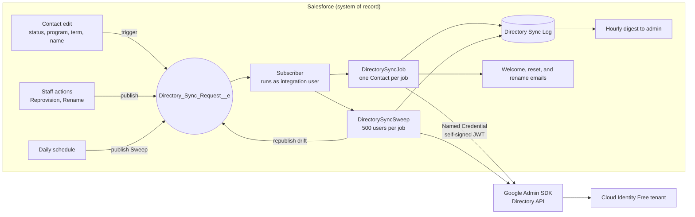

Every path into Google goes through the same platform event and the same integration user. The schedule and the staff actions never call Google themselves: scheduled Apex cannot make callouts, and staff do not hold the callout credential.

## Security design

- **No domain-wide delegation, no super admin.** A Google service account holds a custom admin role limited to Users (create, read, update) and Groups (read, update). No delete. Admin accounts are out of its reach.
- **No key file exists.** The signing key pair was generated in Salesforce with the private key marked non-exportable; only the public certificate was uploaded to Google. Salesforce signs a fresh JWT for each callout through a Named Credential, so there is no token handling in Apex.
- **One narrow exception to Google's security baseline:** service account key upload is allowed for this one project. Key creation stays disabled.
- **The callout credential belongs to one user.** Only the API-only integration user holds the permission set that can call Google. Staff who edit records, run the actions, or schedule jobs cannot.
- **The integration user sees only in-scope records.** Account sharing is Private; a criteria sharing rule exposes only Accounts flagged in scope, and the job runs with sharing.
- **Staff actions are gated twice.** Reprovision and Rename each check a custom permission and a 10-minute cooldown per student, and log who asked.
- **Secrets stay out of logs.** Passwords are redacted from every request and response summary before anything is written.
- **Detective control where a preventive one is impossible.** Google cannot scope a service account's role to one OU, so the sweep flags any user carrying a Salesforce ID outside the student OU tree.

## Reliability design

- **Idempotent by construction.** Look up by Salesforce ID before any create; key every update on the immutable Google user ID; treat "already a member" and "not a member" as success.
- **Callouts first, then email, then database writes,** so a failure never leaves a half-written record that blocks the next attempt.
- **Retries with backoff:** rate limits, quota errors, 5xx, and timeouts re-run the whole job after 1, 2, then 4 minutes, up to 4 attempts. Retry decisions branch on Google's error reason, not the status code, because a 403 can mean either a quota error or a permission error.
- **Alerts with a budget:** final failures are collected into one digest email per hour, at most 3 a day, because alerts share the org's daily email limit with welcome emails.
- **Trust writes, reconcile later.** Google's reads can lag its writes, so nothing reads back to verify. The sweep catches drift instead, and its first live run did: a student whose account sat in the wrong OU, repaired through the normal path.

## Evidence

Screenshots from the live tenant and org, redacted for public view (Google user IDs, the signing key ID, personal email addresses, and org links removed).

**Free tier and least privilege**

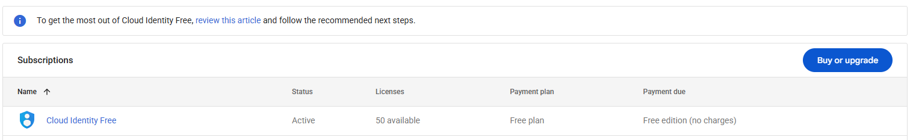
*The Google side runs on Cloud Identity Free: 50 licenses, no charges.*

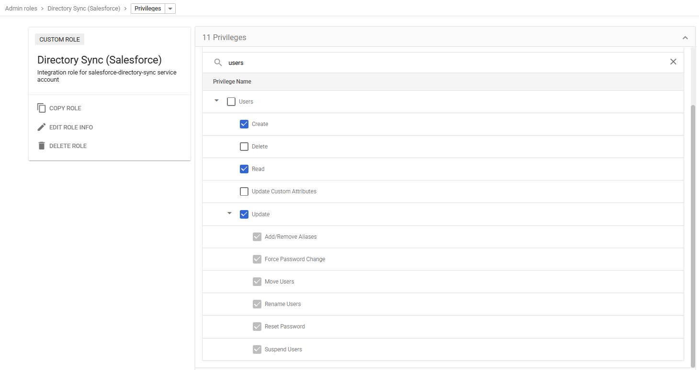
*The integration's custom role: 11 privileges in total. Users can be created, read, and updated, never deleted. Checking Update forces its six children, the trade-off explained in the brief.*

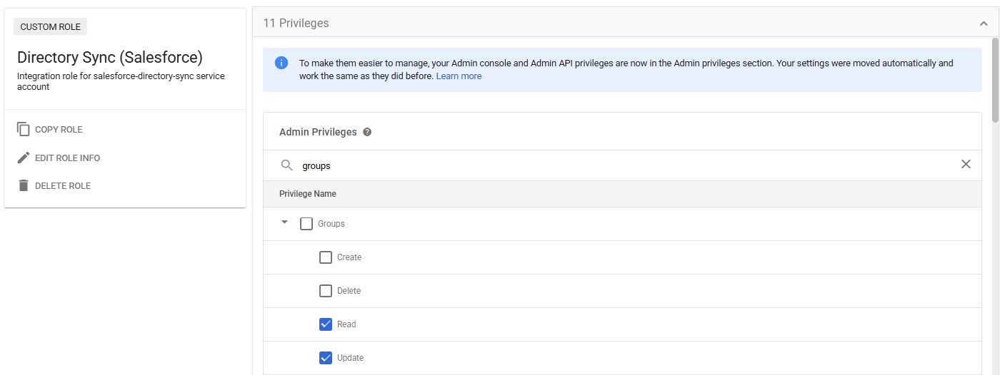
*Groups: read and update membership only. The integration cannot create or delete groups.*

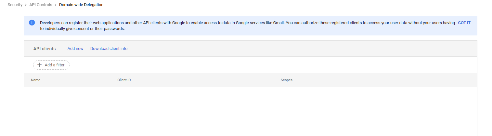
*No client has domain-wide delegation, so nothing can impersonate a user. The service account acts only through its own role.*

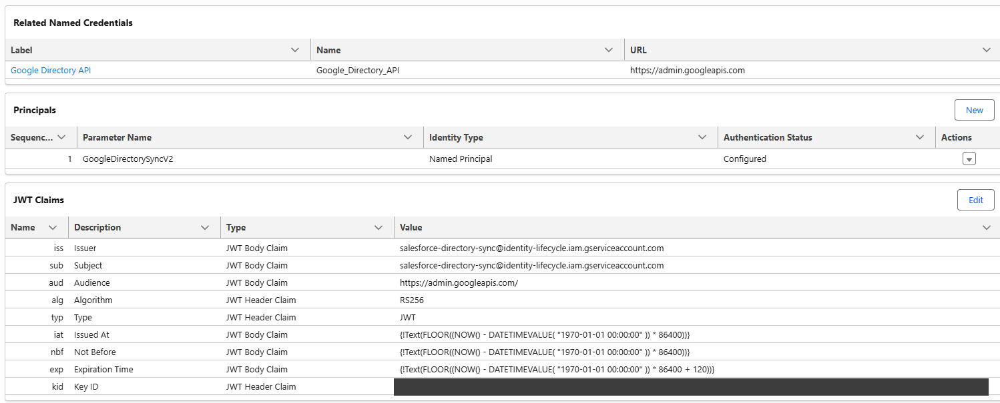
*Salesforce signs a fresh JWT for every callout (120-second expiry) with a key that cannot be exported. Key ID redacted.*

**Structure and placement**

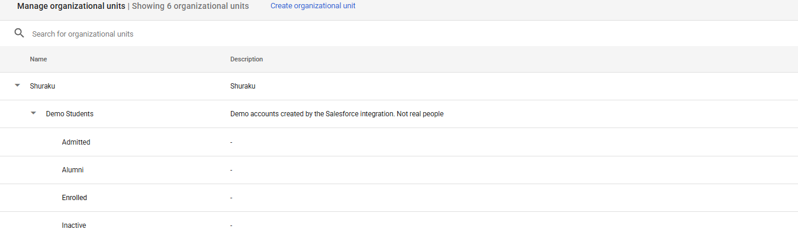
*The OU tree is created by hand. The integration only places users into it.*

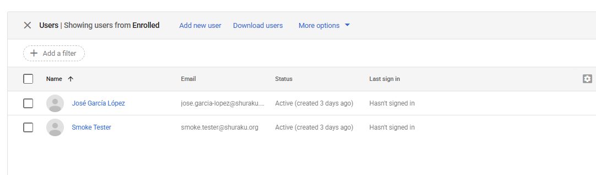
*Both demo students in Enrolled, matching their status in Salesforce, under their renamed usernames.*

**State and audit trail on the record**

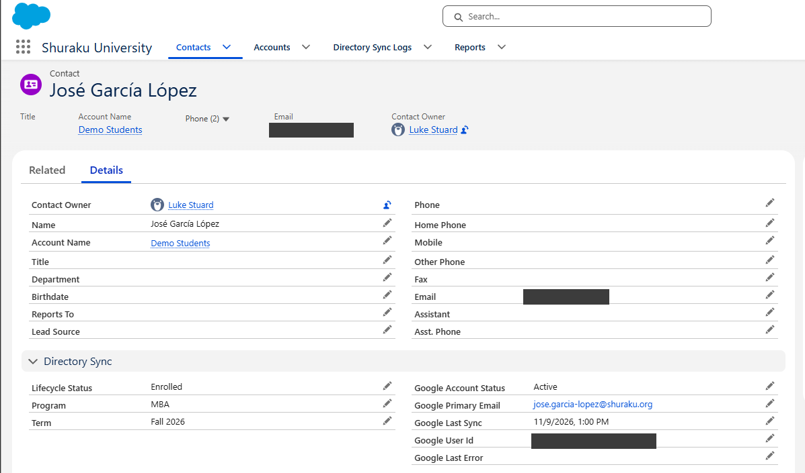
*Sync state lives on the student record: status, Google username, last sync, last error.*

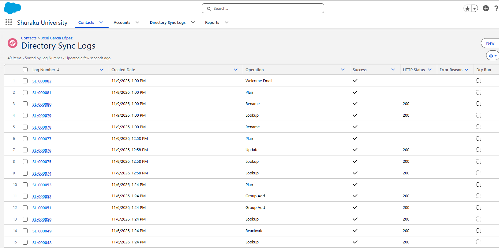
*Every call is logged on the record. Top to bottom (newest first): a staff-requested rename, then the automatic display-name update after the name fields were corrected, then earlier lifecycle runs.*

**Reconciliation finding real drift**

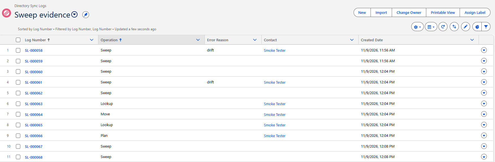
*The first live sweep found a student whose account sat in the wrong OU (SL-000058). The second run republished a sync request, the job moved the account (SL-000063 to SL-000066), and the third sweep came back clean.*

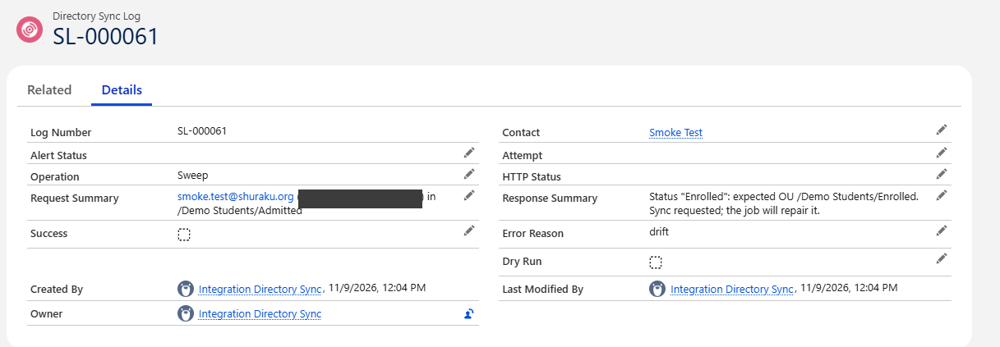
*What the sweep saw: status Enrolled in Salesforce, account still in Admitted in Google.*

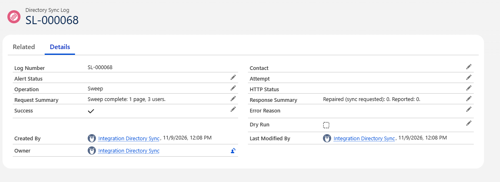
*The follow-up sweep: 3 users, nothing to repair, nothing to report.*

**Alerts and staff actions**

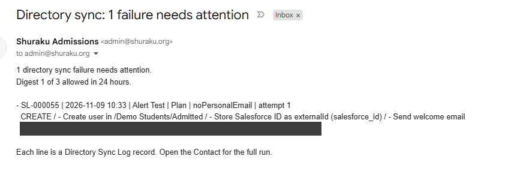
*A final failure (a student with no personal email for the welcome message) reaches the hourly digest. Link redacted.*

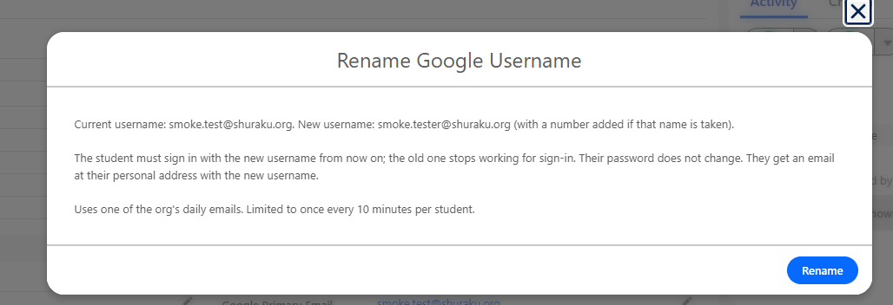
*The Rename action previews the new username and spells out the consequences before anything changes.*

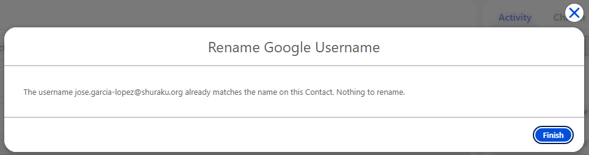
*When the username already matches the name, the action stops without sending anything.*

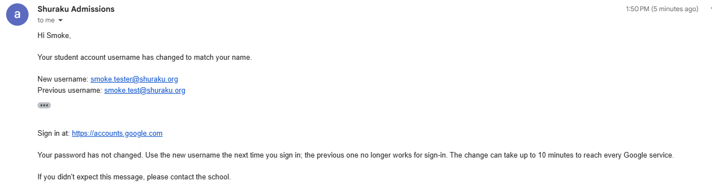
*The student's notice after a rename: both usernames, no password.*

## What it doesn't do

- **No account deletion.** Suspension is the end state, consistent with a retention-first policy.
- **The sweep does not check group membership.** That would cost one call per user; the job reconciles groups on every event instead.
- **Leavers come from a Salesforce status field.** In a real deployment, leave and withdrawal signals would come from the student information system.
- **Temporary passwords travel by email.** Google has no time-limited access pass for this flow. Mitigations: random 20-character password, forced change at first sign-in, personal address only.
- **No duplicate-person detection.** The Salesforce ID prevents a second account for the same record, not for the same person entered twice.
- **Old aliases are not cleaned up after a rename,** and on Cloud Identity Free they receive no mail (there is no Gmail). On a Workspace tenant, mail to the old address would still arrive.
- **Developer Edition limits apply:** 15 single emails a day, and a Queueable chain of 5, which caps retries at 4 attempts and one sweep at 2,500 users.
- **Retries are not used for staff actions.** A retry could send a second password or rename twice; a person can ask again after the cooldown.
- **It depends on Google accepting self-signed JWTs** for the Directory API. A token-exchange fallback in Apex is proven but not wired in.
- **No SSO.** Google as an identity provider for other apps is a possible follow-up on the same tenant.

## Built with

Apex (Queueable with Finalizers, platform event triggers, invocable methods, Schedulable), Platform Events, Named and External Credentials (JWT protocol), Custom Metadata, custom permissions, screen flows and quick actions, Google Admin SDK Directory API, Google Cloud Identity Free, and Cloudflare (DNS and email routing).

## Tests

144 Apex tests. Every Google call in a test goes through a routed `HttpCalloutMock` that fails the test on any unplanned request, so tests prove both what was sent and what was not.

```
sf apex run test --test-level RunLocalTests --result-format human --wait 10
```

## Repository layout

```
force-app/main/default/
  classes/          Apex: client, planner, joiner, mover, job, sweep, alerts, actions, tests
  triggers/         Contact trigger and platform event subscriber
  objects/          Contact sync fields, sync log, request event, Custom Metadata types
  customMetadata/   Settings, status mapping, group mapping
  flows/            Reprovision and Rename screen flows
  quickActions/     Contact actions
  permissionsets/   Integration user, callout credential, admin access
docs/
  BRIEF-identity.md     Design, decisions, risks, open questions
  PROGRESS-identity.md  Build log, including what failed and why
scripts/apex/       One-off scripts for live tests and scheduling
```

## Documentation

- [`docs/BRIEF-identity.md`](docs/BRIEF-identity.md): goals, the original's lessons, every design decision with its reason, limits, risks, and open questions.
- [`docs/PROGRESS-identity.md`](docs/PROGRESS-identity.md): the build in order, including dead ends (an OAuth token exchange that failed with a blank error), live findings, and fixes.
